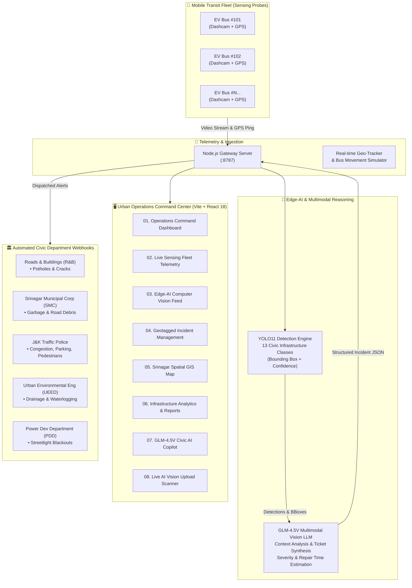

# 🚌 FleetVision-AI

<div align="center">

[](https://opensource.org/licenses/MIT)
[](https://react.dev/)
[](https://vitejs.dev/)
[](https://tailwindcss.com/)
[](https://leafletjs.com/)
[](https://github.com/ultralytics/ultralytics)
[](https://open.bigmodel.cn/)
[](https://nodejs.org/)

**AI-Powered Mobile Sensing Platform & Edge-AI Fleet Telemetry for Smart Urban Infrastructure**

*Turning public transit fleets into real-time civic sensing probes for proactive municipal governance.*

[Key Features](#-key-features) • [Architecture](#-system-architecture) • [YOLO11 Detection Classes](#-13-yolo11-detection-classes--civic-routing) • [Getting Started](#-getting-started) • [API & Config](#-environment-variables) • [Project Structure](#-project-structure)

</div>

---

## 📌 Executive Summary

Traditional civic infrastructure inspection relies on expensive manual surveys or reactive citizen complaints. Potholes deepen into hazardous craters, storm drains clog unnoticed before flash floods, and unauthorized road blockages disrupt entire traffic arteries before municipal authorities can respond.

**FleetVision-AI** transforms everyday municipal transport fleets (such as public electric buses) into **autonomous, mobile edge-sensing observatories**. As buses navigate daily transit corridors, vehicle-mounted cameras feed high-resolution optical video to an edge/cloud intelligence pipeline:

1. **Computer Vision (YOLO11)** continuously identifies road defects, obstructions, structural anomalies, and traffic violations across **13 civic categories**.
2. **Multimodal Generative AI (GLM-4.5V)** evaluates the visual scene, assesses severity, drafts actionable dispatch recommendations, and calculates priority scores.
3. **Geospatial Command Center** visualizes live vehicle telemetry, geotags defects with sub-meter precision, tracks SLA deadlines, and dispatches automated tickets to municipal department webhooks.

> Originally conceptualized for **Smart City Srinagar (J&K)**, the platform is architected to scale across any metropolitan transit authority worldwide.

---

## ⚡ System Architecture



---

## 🌟 Key Features

### 1. 🎛️ Urban Operations Command Center (Dashboard)
- **Live Fleet KPIs:** Active buses on route, real-time AI detections counter, road quality index (RCI), and critical issue tickers.
- **Priority Corridors Alert:** Instant alerts for high-density corridors (e.g., *Lal Chowk, Dalgate, Boulevard Road, Hazratbal*).
- **Incident Heat Strip:** High-contrast visual cues for high-risk zones requiring swift municipal mobilization.

### 2. 🚌 Live Sensing Fleet Telemetry
- **Continuous GPS Tracking:** Live vehicle coordinates, route completion progress, velocity meters, and hardware telemetry.
- **Camera Health Monitoring:** Real-time stream diagnostics (30 FPS HD, optical status, connection latency).
- **Fleet Scalability Controls:** Dynamically scale simulated or connected fleets from 10 to 20+ buses.

### 3. 🎯 Edge-AI Computer Vision Feed
- Real-time simulation of onboard vehicle perception systems.
- Sub-second inference latency indicators and confidence probability meters.
- Multi-defect frame isolation with target locking indicators.

### 4. 📋 Geotagged Incident Management & SLA Tracking
- **Automated Ticket Generation:** Incidents are generated with unique IDs, exact GPS geotags, timestamped photo evidence, and department tags.
- **Strict SLA Timers:** Enforces departmental SLAs (e.g., Waterlogging: 6 hours; Potholes: 24 hours; Congestion: 30 minutes).
- **Lifecycle Auditing:** Full state transitions from `Reported` ➔ `In Progress` ➔ `Resolved`.

### 5. 🗺️ Spatial City Map (Interactive Leaflet GIS)
- **High-Performance Spatial Overlay:** Dynamic markers showing live bus positions and geotagged incident clusters.
- **Transit Route Polyline Layers:** Color-coded multi-stop route lines across key municipal arterial roads.
- **Interactive Inspection Popups:** Click any vehicle or incident marker for instant telemetry and photo inspection.

### 6. 📊 Infrastructure Analytics & SLA Reporting
- **Departmental Workload Breakdown:** Distribution charts across R&B, SMC, Traffic Police, UEED, and PDD.
- **Severity Distribution:** Critical vs. High vs. Medium defect ratios rendered with Recharts.
- **Road Deterioration Trends:** Longitudinal condition tracking to predict road resurfacing requirements before total failure.

### 7. 🤖 Emergent LLM Decision Support (GLM-4.5V Copilot)
- **Conversational Civic Analyst:** Integrated chat assistant with live grounding in current fleet telemetry, open incident logs, and SLA risks.
- **Pre-Engineered Quick Queries:** Instant answers for *"Pothole hotspots"*, *"Waterlogging alerts"*, *"SLA breach risks"*, and *"Fleet efficiency"*.
- **Multimodal Situational Awareness:** Capable of synthesizing text analysis combined with visual defect verification.

### 8. 📸 Live AI Vision Scanner (Image & Video Upload)
- **Direct Asset Inspection:** Upload any road inspection photograph or video file directly from the browser.
- **13 Built-in Category Presets:** Instant testing mode with seeded high-resolution datasets for all supported categories.
- **Dynamic Bounding Box Visualization:** Toggle between rectangle and focus-circle modes with customizable confidence thresholds.
- **One-Click Incident Escalation:** Immediately convert raw detection output into a verified civic ticket dispatched to department webhooks.

### 9. 🎨 Modern UI & Experience
- **Fluid Light & Dark Mode:** Designed with semantic CSS tokens and theme transitions.
- **High-Information Density Typography:** Built with `Inter` and `JetBrains Mono` for mission-critical operations clarity.
- **Interactive Control Center Modal:** Live simulation speed adjusting (1x, 2x, 5x), defect injection, and scenario testing.

---

## 🏷️ 13 YOLO11 Detection Classes & Civic Routing

Every detected hazard or object is automatically mapped to the responsible civic body, configured with a default severity rating, and assigned an enforced SLA window:

| # | Category Key | Class Label | Responsible Department | Severity | SLA Target |
|:---:|:---|:---|:---|:---:|:---:|
| 1 | `pothole` | Pothole / Surface Fracture | **Roads & Buildings Dept (R&B)** | `Critical` | 24 Hours |
| 2 | `road_crack` | Road Crack / Pavement Damage | **Roads & Buildings Dept (R&B)** | `High` | 48 Hours |
| 3 | `waterlogging` | Waterlogging / Storm Drain Overflow | **Urban Environmental Eng (UEED)** | `High` | 6 Hours |
| 4 | `pedestrian` | Pedestrian Obstruction / Crowding | **J&K Traffic Police** | `Medium` | 2 Hours |
| 5 | `car` | Unauthorized / Stopped Vehicle | **J&K Traffic Police** | `Low` | 1 Hour |
| 6 | `bus` | Bus / Commercial Transport Violation | **J&K Traffic Police** | `Low` | 1 Hour |
| 7 | `bike` | Motorcycle / Two-Wheeler Violation | **J&K Traffic Police** | `Low` | 1 Hour |
| 8 | `traffic_congestion` | Traffic Congestion Hotspot | **J&K Traffic Police** | `High` | 30 Mins |
| 9 | `illegal_parking` | Illegal Parking / Double Parking | **J&K Traffic Police** | `Medium` | 2 Hours |
| 10 | `debris` | Road Debris / Construction Waste | **Srinagar Municipal Corp (SMC)** | `High` | 4 Hours |
| 11 | `garbage` | Uncollected Garbage / Solid Waste | **Srinagar Municipal Corp (SMC)** | `Medium` | 12 Hours |
| 12 | `damaged_sign` | Damaged / Missing Road Sign | **J&K Traffic Police** | `Medium` | 48 Hours |
| 13 | `streetlight_failure` | Streetlight Failure / Dark Zone | **Power Development Dept (PDD)** | `Low` | 72 Hours |

---

## 🛠️ Tech Stack

### Frontend Application
- **Core:** [React 18](https://react.dev/) + [Vite 5](https://vitejs.dev/) (Fast Refresh, SWC)
- **Styling:** [Tailwind CSS v4](https://tailwindcss.com/) with custom CSS design tokens
- **Icons:** [Lucide React](https://lucide.dev/)
- **Geospatial Mapping:** [Leaflet 1.9](https://leafletjs.com/) + [React-Leaflet 4](https://react-leaflet.js.org/)
- **Data Visualization:** [Recharts 2](https://recharts.org/)
- **State Management:** Custom Context Architecture (`UrbanDataContext`, `ThemeContext`)

### Backend & AI Ingestion Service
- **Runtime:** [Node.js](https://nodejs.org/) (Native ES Modules, zero heavy framework overhead)
- **API Endpoints:**
  - `POST /api/assistant` — GLM-4.5V LLM conversational interface
  - `POST /api/analyze` — YOLO11 object detection + GLM multimodal scene classification
  - `POST /api/reports` — Webhook dispatcher for municipal authority systems
- **Object Detection:** Ultralytics YOLO11 (Local FastAPI endpoint or cloud inference API; contains automatic realistic mock fallbacks for offline demo mode)
- **Vision-Language Model:** ZhipuAI GLM-4.5V / GLM-4-flash multimodal reasoning

---

## 🚀 Getting Started

### Prerequisites
- **Node.js** `v18.0.0` or higher
- **npm** `v9.0.0` or higher
- *(Optional)* Python 3.10+ (if hosting a local Ultralytics YOLO11 inference API)

### 1. Clone the Repository
```bash
git clone https://github.com/dipesh097/FleetVision-AI.git
cd FleetVision-AI
```

### 2. Install Dependencies
```bash
npm install
```

### 3. Configure Environment Variables
Copy the server example environment file:
```bash
cp server/.env.example server/.env
```
*(See [Environment Variables](#-environment-variables) below for details. If you leave keys blank, the system automatically runs in high-fidelity demo mode with realistic mock detections and classifications!)*

### 4. Start the Application

You can launch both the frontend and backend server concurrently with a single command:

```bash
npm run dev:full
```

Or run them individually in separate terminal sessions:

```bash
# Terminal 1: Backend API Server (:8787)
npm run server

# Terminal 2: Vite Frontend Dev Server (:5173)
npm run dev
```

Open your browser and navigate to:
```
http://localhost:5173
```

---

## ⚙️ Environment Variables

The backend API server reads configuration from `server/.env`:

```ini
# Server Port
PORT=8787

# ── GLM-4.5V (ZhipuAI Multimodal Vision LLM) ──
# Register and get your API key from: https://open.bigmodel.cn/
GLM_API_KEY=your_glm_api_key_here
GLM_API_URL=https://open.bigmodel.cn/api/paas/v4/chat/completions
GLM_MODEL=glm-4.5v

# ── YOLO11 Inference Endpoint ──
# Self-hosted Ultralytics FastAPI or Cloud (Roboflow) endpoint.
# Leave blank to use built-in realistic demo inference mode!
YOLO_API_URL=http://localhost:8000/detect
YOLO_API_KEY=

# ── External Webhook Delivery (Optional) ──
AUTHORITY_REPORT_WEBHOOK=https://your-civic-portal.gov.in/api/incidents
ADMIN_REPORT_WEBHOOK=https://your-admin-monitoring.gov.in/api/alerts
```

---

## 📁 Project Structure

```
FleetVision-AI/
├── server/
│   ├── index.js                     # Node.js API server (YOLO11 & GLM-4.5V proxy, webhooks)
│   └── .env.example                 # Template for backend environment variables
├── src/
│   ├── assets/                      # Static branding assets and images
│   ├── components/
│   │   ├── common/
│   │   │   ├── BadgesAndCards.jsx   # Severity and Department UI badges
│   │   │   ├── DemoBanner.jsx       # Presentation status top banner
│   │   │   └── DemoControlCenterModal.jsx # Simulation speed, fleet size, injection controls
│   │   ├── layout/
│   │   │   ├── Header.jsx           # Top navigation bar with telemetry quick-stats
│   │   │   └── Sidebar.jsx          # Tab navigation across all 8 modules
│   │   ├── map/
│   │   │   └── SrinagarMap.jsx      # Leaflet geospatial map with custom markers & routes
│   │   └── views/
│   │       ├── DashboardView.jsx          # [01] Urban operations command center
│   │       ├── LiveFleetView.jsx          # [02] Live sensing fleet telemetry
│   │       ├── AIDetectionView.jsx        # [03] Edge-AI computer vision feed
│   │       ├── IncidentsView.jsx          # [04] Geotagged incident tickets & SLAs
│   │       ├── CityMapView.jsx            # [05] Full-screen spatial city GIS view
│   │       ├── AnalyticsReportsView.jsx   # [06] Infrastructure metrics & chart reports
│   │       ├── AIAssistantView.jsx        # [07] GLM-4.5V emergent LLM decision support
│   │       └── LiveUploadDetectionView.jsx# [08] Live AI vision upload scanner (13 categories)
│   ├── services/
│   │   ├── ThemeContext.jsx         # Dark / Light theme provider
│   │   ├── UrbanDataContext.jsx     # Master state, simulation engine, incident store
│   │   ├── detectionService.js      # Client detection façade & category registry
│   │   ├── glmService.js            # GLM-4.5V client API wrapper
│   │   └── srinagarData.js          # Srinagar GIS routes, stops, seeded defects & metadata
│   ├── App.jsx                      # Application shell & routing
│   ├── index.css                    # Tailwind CSS v4 directives & custom theme variables
│   └── main.jsx                     # Vite React root mounting
├── index.html                       # HTML5 entry with Leaflet & font imports
├── package.json                     # Project scripts and dependencies
├── vite.config.js                   # Vite configuration with API proxy
└── README.md                        # Project documentation
```

---

## 🛣️ Public Transit Routes (Srinagar Pilot)

FleetVision-AI includes pre-configured geospatial coordinate routes spanning Srinagar's key transport corridors:

- **Route 1 (`R1`):** *Lal Chowk Clock Tower ↔ Dalgate ↔ Boulevard Road ↔ Hazratbal Shrine*
- **Route 2 (`R2`):** *Dalgate ↔ TRC ↔ Hyderpora Bypass ↔ Srinagar Airport Corridor*
- **Route 3 (`R3`):** *Batamaloo Terminal ↔ Qamarwari ↔ Soura SKIMS Medical Center*
- **Route 4 (`R4`):** *Pantha Chowk ↔ Sonwar ↔ Zero Bridge ↔ Old Secretariate*
- **Route 5 (`R5`):** *Jehangir Chowk Flyover ↔ Rambagh ↔ Barzulla ↔ Sanat Nagar*

---

## 📈 Roadmap & Future Vision

- [x] **Phase 1:** Core mobile sensing simulation engine and 8-module command dashboard.
- [x] **Phase 2:** Multi-category YOLO11 integration supporting 13 infrastructure classes.
- [x] **Phase 3:** Multimodal GLM-4.5V vision-language situation reports and conversational copilot.
- [ ] **Phase 4:** Edge deployment on NVIDIA Jetson Orin microcomputers mounted on physical buses.
- [ ] **Phase 5:** Citizen verification portal and WhatsApp / SMS municipal alert integration.
- [ ] **Phase 6:** Predictive asphalt deterioration modeling using historical weather and traffic density data.

---

## 🤝 Contributing

Contributions, feedback, and issue submissions are welcome!

1. Fork the repository
2. Create your feature branch (`git checkout -b feature/AmazingFeature`)
3. Commit your changes (`git commit -m 'Add some AmazingFeature'`)
4. Push to the branch (`git push origin feature/AmazingFeature`)
5. Open a Pull Request

---

## 📄 License

This project is licensed under the **MIT License** — see the [LICENSE](LICENSE) file for details.

---

<div align="center">

**Built for Smart Municipalities • Powered by YOLO11 & Multimodal AI**

*Crafted with ❤️ for Smart India Hackathon (SIH)*

</div>
